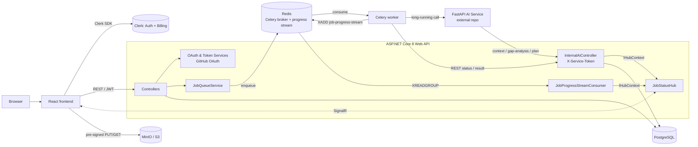

# Work@X — AI Job Intelligence Platform

Upload your CV, chat with an AI career assistant about a target role, and get a **gap analysis** and a **personalized study plan** — backed by your CV, GitHub, and LinkedIn profile.

Work@X is a three-tier system (React · ASP.NET Core · Celery) that orchestrates long-running AI work through an asynchronous job pipeline, with real-time progress pushed to the browser over SignalR.

---

## Features

- **Onboarding** — CV upload is required; GitHub (OAuth) and LinkedIn (profile URL) are optional.
- **Automatic profile analysis** — confirming a CV upload automatically queues an analysis job that parses the CV and scrapes the linked GitHub/LinkedIn data. No user action needed.
- **Agentic chat** — every message goes to a single AI endpoint with a minimal payload (`userId`, `jobId`, `sessionId`, context summary, message). The AI service decides which node handles it and pulls any extra data it needs, on demand, from dedicated internal endpoints.
- **Gap analysis → study plan** — a gap analysis can present choices; clicking "Create study plan" sends the AI a synthesized message describing the user's selections.
- **Session management** — switch freely between chat sessions; history, gap analyses, and study plans are reconstructed from stored data.
- **Rolling context summary** — after each AI response the session summary is updated with the latest exchange.
- **Smart result routing** — responses are persisted to the right place (chat messages, gap analyses, or study plans) depending on their type.
- **Live progress** — job stage/percent streamed to the UI via SignalR (with polling fallback).
- **Auth & billing** — Clerk handles sign-in and plan tiers (`free` / `pro` / `elite`).

---

## Architecture



**Key design points**

- **The worker has no database access.** It talks to the backend exclusively over the internal REST endpoints (job status, result submission, resume download URL, profile scores). Only the backend writes to PostgreSQL.
- **Files bypass the API.** CVs are uploaded straight from the browser to MinIO via pre-signed URLs.
- **The AI service is a separate project** (different repo/team). It is called by the worker, and it calls back into the backend's internal endpoints for on-demand context. Until it is available, the worker runs with `MOCK_AI=true`.
- **LinkedIn is a plain URL**, not an OAuth integration — it is forwarded to the AI service for scraping.

### Job lifecycle

```
queued → processing → completed
                   └→ failed
```

The job record is created first, *then* the message is published to the queue, so the record always exists before a worker can pick it up.

---

## Tech stack

| Layer | Stack |
|---|---|
| Frontend (`FE/`) | React 19, Vite, TypeScript, Ant Design, Clerk, SignalR client |
| Backend (`BE/`) | ASP.NET Core 8, EF Core + Npgsql, JWT (Clerk), SignalR, StackExchange.Redis, AWS S3 SDK |
| Worker (`Worker/`) | Python 3.11, Celery 5, redis-py |
| Data | PostgreSQL 16, MinIO (S3-compatible), Redis 7 |
| External | Clerk (auth + billing), GitHub OAuth, FastAPI AI service |

---

## Repository layout

```
├── BE/                 ASP.NET Core API, EF Core models & migrations, SignalR hub
├── FE/                 React SPA
├── Worker/             Celery worker, AI client, progress publisher, tests
├── REDIS/              Redis notes (broker + progress stream)
├── contracts/          JSON schemas shared across teams
├── docker/             Container support files
├── scripts/            OS-specific startup scripts
├── CONTRACTS.md        Cross-team interface contracts (jobs, endpoints, payloads)
├── AGENTS.md           Repo guide; per-component AGENTS.md files live in each folder
├── docker-compose.yml
└── startup.sh          One-command startup
```

---

## Getting started

### Prerequisites

- Docker + Docker Compose
- A [Clerk](https://clerk.com) application (publishable key + authority URL)
- (Optional) A GitHub OAuth app for the GitHub connection
- (Optional) A Groq API key for the summarizer

### Run

```bash
cp .env.development .env     # then fill in your values
./startup.sh                 # builds and starts the whole stack
```

Or manually:

```bash
docker compose up -d --build
docker compose logs -f
docker compose down
```

### Services & ports

| Service | URL / Port |
|---|---|
| Frontend (Docker) | http://localhost:4200 |
| Frontend (Vite dev) | http://localhost:5173 |
| Backend API | http://localhost:5000 |
| MinIO API / Console | 9000 / http://localhost:9001 |
| PostgreSQL | 5432 |
| Redis | 6379 |

---

## Configuration

Copy `.env.development` to `.env` (gitignored). **Never commit real secrets.**

| Variable | Purpose |
|---|---|
| `DB_PASSWORD` | PostgreSQL password |
| `CLERK_AUTHORITY` / `VITE_CLERK_PUBLISHABLE_KEY` | Clerk auth (backend / frontend) |
| `VITE_API_URL` | Backend URL used by the frontend |
| `MINIO_ROOT_USER` / `MINIO_ROOT_PASSWORD` | MinIO credentials |
| `AWS_ACCESS_KEY_ID` / `AWS_SECRET_ACCESS_KEY` / `AWS_REGION` / `S3_BUCKET_NAME` / `S3_ENDPOINT` | S3-compatible storage settings |
| `GITHUB_CLIENT_ID` / `GITHUB_CLIENT_SECRET` | GitHub OAuth app |
| `ENCRYPTION_KEY` | AES-256 key for encrypting OAuth tokens at rest |
| `CELERY_TASK` / `CELERY_QUEUE` | Celery task name and queue |
| `SERVICE_AUTH_TOKEN` | Shared secret (`X-Service-Token`) for worker/AI → internal endpoints |
| `SUMMARIZATION_PROVIDER` / `_API_URL` / `_API_KEY` / `_MODEL` | Session-context summarizer |
| `MOCK_AI` | `true` = worker returns mock AI responses (default in dev) |
| `AI_SERVICE_BASE_URL` | Address of the external FastAPI AI service |

---

## Internal API (service-to-service)

Protected by the `X-Service-Token` header — **not** for browsers. Do not expose publicly.

| Method | Route | Used by | Purpose |
|---|---|---|---|
| GET | `/api/internal/ai/context/{userId}` | AI service | Full profile context (CV, GitHub, LinkedIn analysis) |
| GET | `/api/internal/ai/gap-analysis/{userId}` | AI service | Previous gap analyses |
| GET | `/api/internal/ai/plan/{userId}` | AI service | Previous study plans |
| GET | `/api/internal/ai/jobs/{jobId}` | Worker | Fetch job details |
| POST | `/api/internal/ai/jobs/{jobId}/status` | Worker | Mark job processing |
| POST | `/api/internal/ai/jobs/{jobId}/result` | Worker | Submit result (backend persists + routes it) |
| GET | `/api/internal/ai/resume/{resumeFileId}/download-url` | Worker | Pre-signed CV download URL |
| POST | `/api/internal/ai/profile-scores/{userId}` | Worker | Store profile scores |

See [`CONTRACTS.md`](CONTRACTS.md) for payload schemas.

---

## Testing the pipeline

Worker test utilities live in `Worker/tests/`:

```bash
# Publish a test job
python Worker/tests/send_test_job.py

# Watch the progress stream
python Worker/tests/read_progress_stream.py

# Failure / retry behaviour
pytest Worker/tests/test_failure_injection.py
```

Swagger is available on the backend in development.

---

## Roadmap

- AI Tutor, Mock Interview, and CV Optimizer (routes exist as `501` stubs; planned for a later phase)
- Re-run profile analysis when GitHub is connected or the LinkedIn URL changes after onboarding
- Network isolation for `/api/internal/*`
- Idempotency guard for tech-choice submissions

---

## Contributing

Read [`AGENTS.md`](AGENTS.md) first, then the `AGENTS.md` in the component you're working on. Interface changes go through [`CONTRACTS.md`](CONTRACTS.md).

## License

Add a license of your choice (e.g. MIT) before publishing.
